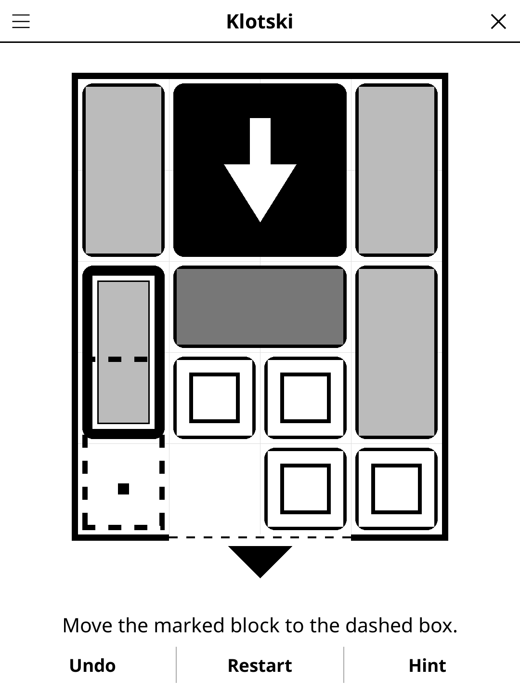

# klotski.koplugin

**Klotski** (FR « L'Âne rouge ») — the classic sliding-block puzzle for
[KOReader](https://github.com/koreader/koreader): free the big square from a
crowded tray.

## Screenshot

## Rules

1. The tray is 4 squares wide and 5 high, with a gap two squares wide in the
   middle of the bottom wall. Bring the big 2×2 block (black, white arrow)
   down to it: the level is solved when it sits on the two bottom rows, in
   the middle.
2. Blocks — 2×2, vertical 1×2, horizontal 2×1 and small 1×1 — slide up,
   down, left or right into empty squares, never through one another.
3. One move is one block going anywhere it can reach, **even round a
   corner**, as long as no other block moves in between: moving the same
   block again straight after is still the same move. Each level shows its
   optimal number of moves in that count; matching it is a perfect score.

This is the usual count for the puzzle: in it, the traditional start (the
"Red Donkey", also known as *Forget-me-not* or *Hua Rong Dao*) takes 81
moves.

## Features

- **Classics** — the Red Donkey (81 moves) and three other traditional
  openings (70, 60 and 72 moves), plus the four hardest starts found by the
  generator (93, 97, 135 and 138 moves).
- **1600 generated levels**, 400 per difficulty, graded by optimal moves:
  *Easy* 5–15, *Medium* 16–35, *Hard* 36–60, *Expert* 61–138. Each band is
  ordered from its easiest level to its hardest.
- **Progress** — "New game" opens the next level you haven't solved; the
  *Level* menu lists every level of the difficulty (✓ on solved ones) and the
  *Difficulty* menu shows how many you've solved.
- **Daily Challenge** — the same level for everyone today (an Expert level
  when Classics is selected).
- **Hint** — two taps: the first marks the block to move and outlines its
  destination, the second plays it. Hints always follow an optimal solution
  from where you are, so each one brings the exit one move closer.
- **Show solution** — gives up the level and steps through an optimal
  solution, forwards and back.
- **Undo**, **Restart**, moves counter, timer and auto-save.

## Controls

| Action | How |
|--------|-----|
| Select a block | Tap it (dots mark the empty squares it can reach) |
| Move it | Tap a dotted square (if two places fit, the nearer one), or swipe the block to slide it straight as far as it goes |
| Undo / Restart / Hint | Buttons under the board |
| New game, Daily Challenge, difficulty, level, solution, rules | Title-bar menu |

## Why e-ink friendly?

Black, white and two flat greys: the 2×2 is solid black, vertical blocks light
grey, horizontal ones darker grey, small ones white with an inner frame, each
with a gap around it. No animation and no dragging: a move repaints the
screen once.

## Levels

The generated levels are not taken from any published collection. They are
built offline by `tools/` (not shipped): for every set of blocks that fills
the tray with 2 to 4 empty squares, every legal layout is enumerated, the
layouts are split into clusters (those reachable from one another), and one
breadth-first search from all solved layouts of a cluster gives each layout
its exact optimal move count. A candidate level is a layout that no single
move takes further from solved (so a level is never the middle of a longer
one); mirror images are merged. The picker spreads each band evenly over its
move counts and block sets, and every pick is solved again with the game's
own search. Clusters larger than 100 000 layouts are left out so the hint
search on the reader stays bounded. The game ships the result as
`levels_data.lua`, one line per level (20-character tray + optimal moves).
Rebuild with `tools/build_levels.sh`.

## License

GPL-3.0
